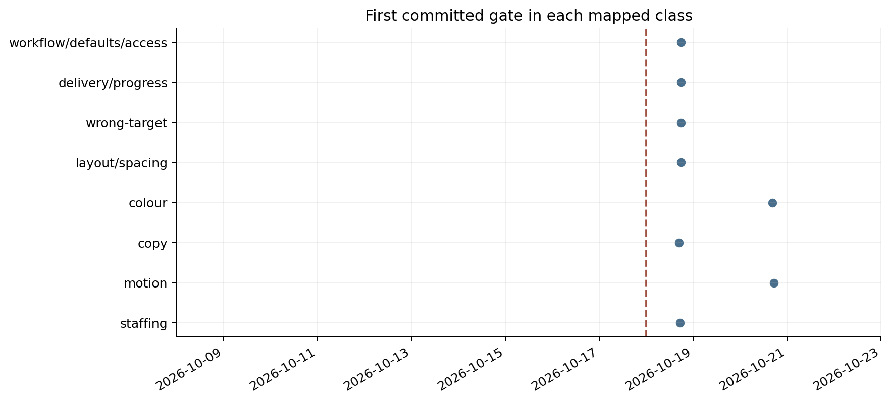
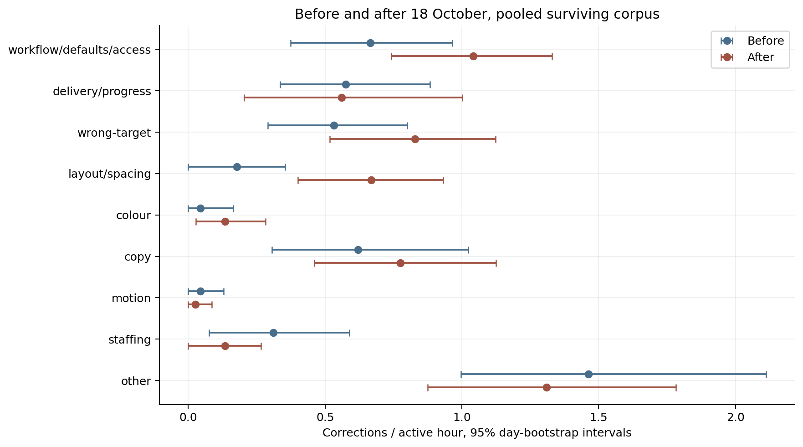
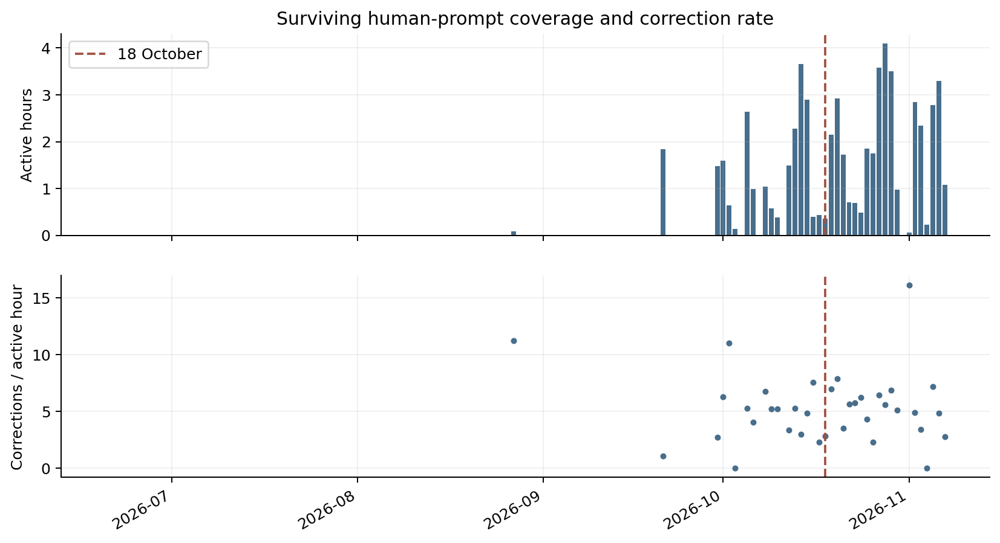
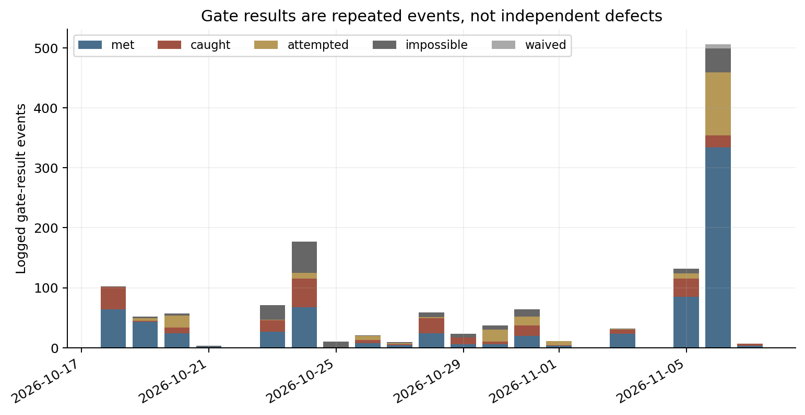

# Correction rates before and after gates

This study asks whether manual corrections fall when gates cover their class. I reconstructed the surviving prompt corpus and measured corrections per active hour. The estimates describe this corpus. They do not identify a causal effect.

## Findings

**Established, within the extracted corpus.** I retained 909 inferred human prompts, including 305 corrections, from 2026-06-20T14:28:35.936000+00:00 to 2026-11-07T13:53:49.780000+00:00. The 30 minute activity rule gives 59.99 hours on 37 days with positive exposure. There are 3 prompt days with no measurable active interval.

**Established, descriptive estimate.** All-class corrections per active hour change from 4.432 before 18 October to 5.477 after it. The change is 1.045, with a 95% day-bootstrap interval [-0.268, 2.211].

**Established, descriptive estimate.** The eight mapped classes change from 2.969 to 4.168 corrections per hour. Their change is 1.198 [0.056, 2.259].

**Argued, with an imperfect comparison group.** The difference-in-differences for the eight mapped classes against the residual other class is 1.352 corrections per hour [-0.063, 2.721]. A negative estimate favours a relative fall. The groups have different widths and other contains defects touched by domain gates. Colour and motion gates arrive later than 18 October. This contrast is exploratory. The observed direction is opposite to the predicted relative fall.

**Conjecture.** Gates replace some manual correction. Registry existence, repeated gate results and a before/after association cannot establish that mechanism without comparable observation and evidence that the relevant gate ran before each prompt.

## Corpus and observation gaps

The snapshot excludes records at or after 2026-11-07T13:58:00+00:00, before this study task started. I scanned both named Claude roots on h and the SSH account on b, plus both local Codex roots and Codex on b. Missing roots are counted as zero files. No model-worker session from this analysis enters the snapshot. Text, project, host, timestamp and session identifier are retained privately.

| Source | Files | Eligible prompts | First retained | Last retained |
|---|---:|---:|---|---|
| h_claude_root | 196 | 239 | 2026-10-24T17:37:47.592000+00:00 | 2026-11-07T13:53:49.780000+00:00 |
| h_claude_gabriel | 28 | 0 | none | none |
| h_codex_root | 1 | 0 | none | none |
| h_codex_gabriel | 0 | 0 | none | none |
| b_claude | 447 | 613 | 2026-08-27T13:47:04.946000+00:00 | 2026-11-06T14:43:24.607000+00:00 |
| b_codex | 362 | 57 | 2026-06-20T14:28:35.936000+00:00 | 2026-10-04T14:49:01.918000+00:00 |

| Month | Prompts | Corrections | Active hours |
|---|---:|---:|---:|
| 2026-06 | 1 | 0 | 0.00 |
| 2026-07 | 0 | 0 | 0.00 |
| 2026-08 | 2 | 1 | 0.09 |
| 2026-09 | 23 | 6 | 3.32 |
| 2026-10 | 714 | 236 | 43.94 |
| 2026-11 | 169 | 62 | 12.65 |

Retention was incomplete. The operator reports automatic deletion after roughly 30 days. Some older records survive on b, but their presence does not prove complete historical coverage. The retained series is sparse before October and h contributes no pre-intervention prompts. Deleted logs cannot be reconstructed and a missing day is not a day with no corrections. The pooled contrast changes host and project composition. The b-only contrast is a sensitivity, not a repair for selective retention.

I drop sidechains, meta records, tool results, compacted summaries, task notifications, local command wrappers, system-origin prompts and accepted model suggestions. Codex metadata excludes headless exec and subagent sessions. I deduplicate the same session, timestamp and text across copied logs. Claude worker-prefix and long-brief rules are in [rubric.md](rubric.md). The primary annotator removes remaining clearly generated briefs. Provenance fields support authorship for newer Claude records, but cannot authenticate older text. Exclusion counts are in [corpus_exclusions.csv](tables/corpus_exclusions.csv).

## Labels and agreement

The fixed [rubric](rubric.md) defines a correction as an explicit mistake, unmet instruction, unwanted action or defect in an existing result. New requests and neutral questions do not count. Each prompt receives one primary class. Luna labels the corpus and Sol independently labels a simple random 15% sample, rounded up, seed 20261018. Annotators see only prompt text and a local index, without dates, hosts, project names, gate status, the claim or each other's labels. The prompt itself can mention dates or projects. No disagreements are adjudicated into the primary labels.

| Measure | Sample | Raw agreement | Cohen's kappa |
|---|---:|---:|---:|
| correction | 137 | 0.891 | 0.738 |
| class | 137 | 0.745 | 0.645 |
| joint correction/class | 137 | 0.672 | 0.596 |
| class among joint corrections | 33 | 0.788 | 0.739 |
| eligibility on retained sample | 137 | 1.000 | not estimable |

Kappa uses observed agreement adjusted for agreement expected from the two label marginals. The calculation follows the [scikit-learn definition](https://scikit-learn.org/stable/modules/generated/sklearn.metrics.cohen_kappa_score.html), implemented directly to avoid a runtime dependency. This is agreement between two models, not validation against a human gold standard. Model-specific eligibility disagreement is reported separately. Self-labelled data is a general threat in an n=1 study. Here, models assign the row labels under a researcher-defined rubric. The labels have not been checked against independent human judgements.

## Gate timing and coverage

The [g-levels registry](https://github.com/Volcanex/g-levels) begins with [commit 1193d87](https://github.com/Volcanex/g-levels/commit/1193d87) on 18 October 2026 at 16:54 UTC. For each current gate I inspect its first adding commit, following renames. I retain the first commit timestamp, author timestamp, original file name, initial origin date and initial written-against date in [gate_registry.csv](tables/gate_registry.csv). Incident narratives are omitted. Some written-against and origin dates predate the registry. They do not establish when a gate became available. The written-date sensitivity is therefore a different assumption, not a preferred deployment history.

The [explicit mapping](gate_map.json) covers eight classes. Coverage is partial. A requirements gate is only a proxy for wrong-target errors and the house-system gate is a proxy for colour. I attach gate availability to each private labelled row after annotation. Availability means that at least one mapped gate existed at that timestamp. It does not mean its charter covered that project or that the sensor ran.

| Class | First committed covering gate, UTC |
|---|---|
| workflow/defaults/access | 2026-10-18T17:44:57+00:00 |
| delivery/progress | 2026-10-18T17:44:57+00:00 |
| wrong-target | 2026-10-18T17:44:57+00:00 |
| layout/spacing | 2026-10-18T17:48:41+00:00 |
| colour | 2026-10-20T16:26:24+00:00 |
| copy | 2026-10-18T16:54:00+00:00 |
| motion | 2026-10-20T17:11:34+00:00 |
| staffing | 2026-10-18T17:10:29+00:00 |

## Exposure and inference

I sort retained human-prompt timestamps across all sources. Consecutive timestamps less than 30 minutes apart define an active interval. A gap of exactly 30 minutes is excluded. I merge overlap across hosts and split intervals at UTC midnight and at each intervention timestamp. There is no added time for isolated prompts or long agent runs. Every class uses the same person-level exposure denominator. Counts on zero-exposure days remain in period numerators. They have no daily rate. Sensitivities use 15 and 60 minute thresholds.

Before/after rates are total class corrections divided by total observed active hours, not averages of daily rates. The global cut is 18 October at 00:00 UTC. Per-class and per-gate comparisons use exact Git birth timestamps and split the exposure at that instant. Gates without a defensible mapping are listed without an estimate. Multiple gates in one class reuse that class's outcome, so later gate contrasts are not incremental effects.

Intervals use 10,000 percentile bootstrap draws with seed 20261018. I resample observed UTC days with replacement separately within each period. Treatment and control counts stay paired within a day in the difference-in-differences. Days split by an exact birth contribute separate portions to the two periods. Bootstrap draws with zero exposure are undefined and excluded from percentiles. Draw counts are published. This is a day-cluster bootstrap, not a causal confidence interval. It does not address serial dependence across days or the many class and gate comparisons. Sampling uses [NumPy's random generator](https://numpy.org/doc/1.26/reference/random/generated/numpy.random.Generator.integers.html).

## Before and after 18 October

| Class | Before count | After count | Before / h | After / h | Change [95% interval] |
|---|---:|---:|---:|---:|---|
| workflow/defaults/access | 15 | 39 | 0.665 | 1.042 | 0.377 [-0.043, 0.781] |
| delivery/progress | 13 | 21 | 0.576 | 0.561 | -0.015 [-0.495, 0.479] |
| wrong-target | 12 | 31 | 0.532 | 0.828 | 0.296 [-0.117, 0.675] |
| layout/spacing | 4 | 25 | 0.177 | 0.668 | 0.491 [0.171, 0.809] |
| colour | 1 | 5 | 0.044 | 0.134 | 0.089 [-0.071, 0.247] |
| copy | 14 | 29 | 0.620 | 0.775 | 0.154 [-0.350, 0.632] |
| motion | 1 | 1 | 0.044 | 0.027 | -0.018 [-0.112, 0.071] |
| staffing | 7 | 5 | 0.310 | 0.134 | -0.177 [-0.485, 0.095] |
| other | 33 | 49 | 1.463 | 1.309 | -0.153 [-0.928, 0.528] |

Every row has 22.56 observed hours before the cut and 37.43 after it. There are 19 observed prompt days before and 21 after. These are observations of one person, not independent participants.

## Difference-in-differences and checks

The contrast is (covered after minus covered before) minus (other after minus other before), in corrections per active hour. Covered pools several classes and other is a broad residual. Parallel trends are neither established nor credible from the short and incomplete pre-period. I also report only classes already represented on the registry creation day and restrict to b to show sensitivity to the later arrival of h logs.

| Contrast | Estimate | 95% interval |
|---|---:|---|
| all mapped classes vs other | 1.352 | [-0.063, 2.721] |
| creation-day mapped classes vs other | 1.280 | [-0.084, 2.606] |
| b only, all mapped classes vs other | 1.353 | [0.010, 2.670] |
| 14 days either side, all mapped classes vs other | 0.879 | [-0.754, 2.337] |

Exact class-birth comparisons are in [class_birth_rates.csv](tables/class_birth_rates.csv). Each current gate appears in [gate_birth_rates.csv](tables/gate_birth_rates.csv). Only 20 of 120 gates have a specific mapping in the fixed taxonomy. The other gate rows have no estimate because their domain outcomes cannot be isolated inside other. The written-date and activity-threshold sensitivities are in [sensitivity.csv](tables/sensitivity.csv). All these estimates are descriptive.

## Gate results over time

**Established, within the surviving results log.** There are 1,373 recorded result events: 203 attempted, 241 caught, 177 impossible, 745 met, 7 waived. Only date, gate identifier, result category and count are exported. Notes, paths, actors and incident details remain private. Dates without entries are no recorded events, not proof that no gate ran. Repeated checks and retries are not unique prevented errors. A caught event is evidence that a sensor reported a failure, not that a human correction was prevented.

## Limitations and interpretation

**Established limitations.** This is n=1 with a short after window and uneven retention. Self-labelled records and researcher-chosen classes can bias interpretation. Model labels can miss implicit corrections, confuse new requests with defects and misread tone. The independent sample estimates reproducibility, not truth. Whole-brief exclusions and metadata gaps can leave or remove agent-written text. Prompt-only active hours omit isolated interactions, offline work and long assistant runs. The rate denominator is an estimate of engagement, not measured labour time. No project-level exposure is inferred.

**Argued threats to inference.** Regression to the mean is plausible because gates were created after salient errors. Changing models, tasks, project mix, logging practices, skills and other process changes can affect rates at the same time. A residual control does not remove those changes, and domain gates contaminate it. Class existence is a weak proxy for actual treatment. Bootstrap intervals reflect observed day variation only. A fall in corrections can also mean abandonment, lower scrutiny or deleted evidence. An increase can mean harder tasks or closer scrutiny.

**Conjecture requiring further evidence.** A prospective study with stable retention, human validation, actual gate-execution exposure and comparable task types could test whether correction work moves from Gabriel to sensors. The present series cannot separate that mechanism from the alternatives above.

## Reproduction and publication boundary

Read [CLAUDE.md](CLAUDE.md) for the file layout. Commands and pinned dependencies are in [run.md](run.md). The private snapshot, row labels, independent sample and model batch evidence are under ignored `data/`. Public outputs contain no prompt text, session identifiers, project-level breakdowns or incident narratives. Public tables and figures can be regenerated only by someone with the private evidence or equivalent source access. The public verification suite uses synthetic examples. No unavailable records are imputed.
